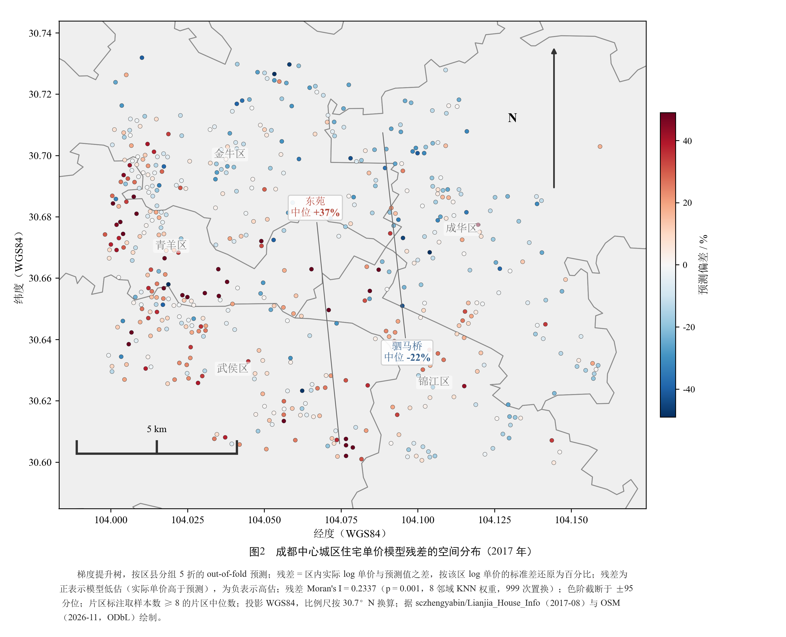
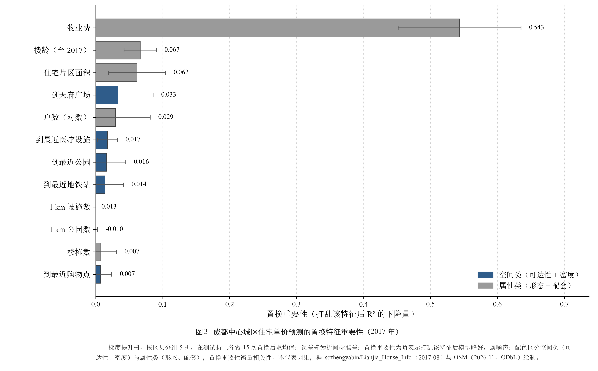

# spatial-price-model：成都住宅单价的空间交叉验证

数据为 2017 年 8 月链家挂牌小区表（10 078 行）与 © OpenStreetMap contributors（ODbL 1.0）设施快照（2026 年）。样本 525 个住宅小区、5 个中心城区、96 个片区、26 个特征，目标变量为区县内 log 单价的 z-score。

结果：同一组特征与超参数下，随机 5 折交叉验证 R² = 0.349，按片区分组 5 折为 0.267，按区县分组为 0.162；随机与按区县相差 18.8 pp，随机与按片区相差 8.3 pp。样本外残差仍呈空间聚集（Moran's I = 0.234，p = 0.001）。


<sub>图 1　成都中心城区住宅单价的交叉验证对比（2017 年）</sub>

## 一、项目内容

1. 坐标获取：链家小区表不含经纬度，按小区名关联 OSM 住宅面质心，名称关联命中 649 行；经同名消歧与薄区剔除后保留 525 个样本，全过程记录在 `build/match_log.json`（原始 10 078 行，7 行字段缺失、3 321 行无价、14 行价格越界、99 行重复单元）。
2. 目标变量：区县内 log 单价的 z-score（区内去均值与去标准差），剔除区县整体的价格水平。
3. 切分对比：随机 5 折、按片区 5 折、按区县 5 折，特征与超参数完全相同，仅切分不同。
4. 残差检验：样本外残差落回地图，双向发散色阶，并以 Moran's I 检验空间自相关。


<sub>图 2　成都中心城区住宅单价模型残差的空间分布（2017 年）</sub>

## 二、报告口径

1. 三套切分全部报出（随机 0.349、按片区 0.267、按区县 0.162），不只报随机切分。
2. 指标取按样本数加权的折均值。各折的 z 基准由训练折单独估计，拼接 OOF 后算全局 R² 不成立（同一套代码拼接得到的线性 R² 为 −0.49，原因是基准错位）。
3. 空间特征做一次单独消融：按区县分组时 R² = −0.579。


<sub>图 3　成都中心城区住宅单价预测的置换特征重要性（2017 年）</sub>

## 三、复现

```bash
pip install -r requirements.txt

python run_model.py                 # 四段全跑：prepare → features → model → figures，约 3.5 分钟
python run_model.py --skip-figures  # 只出数据与指标
python run_model.py --stages model,figures   # 只跑指定段
```

前置依赖 `../geo-etl-pipeline/data/chengdu.db`：设施、地铁站、区县面、住宅单元表由该项目产出，缺文件时 `prepare.py` 报错退出。

| 目录 | 内容 |
|---|---|
| `raw/` | 链家原始表（只读，未修改） |
| `build/` | `samples.csv`（525 行）、`features.csv`（525 × 26）、`oof_predictions.csv`、`cv_results.json`、`match_log.json`、`feature_manifest.csv`、`feature_log.json` |
| `docs/` | 三张图、`data_manifest.md`、`model_card.md` |

`run_model.py` 结尾做四项一致性检查（样本/特征/OOF 行数一致、可达性特征无缺失、3 × 3 组结果齐全、三张图在位），任一不通过以非零码退出。

## 四、设计与取舍

| # | 决定 | 依据 | 代价 |
|---|---|---|---|
| 1 | 目标变量用区内相对价，不用绝对单价 | 绝对价的方差主要由所属区县贡献；价格数据为 2017 年、设施为 2026 年，两者水平差会被算进空间系数 | 结论只覆盖区内差异，不能比较区县均价 |
| 2 | 坐标靠名称关联，不做地理编码 | 链家与贝壳详情页在本机返回拦截页，高德与百度需密钥；名称关联取的是住宅面质心 | 命中率 9.6%，样本偏向规模较大、有名气的小区 |
| 3 | 同名多候选用区县消歧，跨区同名丢弃 | 避免把锦江的小区挂到金牛的坐标 | 少 30 行（21 同区多候选、9 跨区） |
| 4 | 整区剔除新都、龙泉驿 | 两区各仅 11 个样本，区内标准差由 5–6 个值估计，z-score 与残差不可用 | 少 11 行，覆盖退到 5 个中心城区 |
| 5 | 线性支路用岭回归（α = 1） | 26 个特征存在成组共线，OLS 在一折上出现 −4.4e24 的单折 R² | 系数不是无偏 OLS 解 |
| 6 | 指标用折均值，不拼接 OOF 算全局 R² | 各折 z 基准不同，拼接后算全局 R² 无效 | 与常见的全局 R² 口径不同，已在第二节说明 |
| 7 | 三套切分全部报出 | 单报随机切分不反映空间分组的影响，单报按区县不反映方法本身的收益 | 表格变长 |
| 8 | 空间特征单独消融 | 用于回答空间特征在跨区预测中的作用 | 结果（−0.579）不利于空间特征 |
| 9 | 残差用双向发散色阶，0 居中 | 残差有正负，暖色为低估、冷色为高估 | 视觉对比弱于彩虹色 |
| 10 | 三张图的图注写明数据年份与不可用途 | 价格年份与设施年份错位是最主要的攻击点 | 图注文字增多 |

## 五、结果与局限

1. 随机切分与空间分组切分相差 18.8 pp（0.349 对 0.162）；空间数据的精度评估应按空间单元分组。
2. 控制小区自身品质后，物业费一项的置换重要性为 0.543，超过全部空间特征之和；空间特征单独使用时，跨区预测的 R² 为 −0.579。
3. 样本外残差仍呈空间聚集（Moran's I = 0.234，p = 0.001）；残差中未被解释的部分对应学区、商圈成熟度等本数据不含的变量。

局限：样本 525 个且偏向有名小区；价格 2017 年与设施 2026 年时间错位；无学区、商圈、装修数据；置换重要性不等于因果关系；结论只覆盖主城 5 区。

用途限制：不可用于定价、估值、投资建议、信贷评估，不可对外发布片区房价排名。可用于方法演示、教学与变量清单核对。详见 [`docs/model_card.md`](docs/model_card.md)。

## 六、English Summary

A cross-validation study on Chengdu resale-housing prices (5 downtown districts, 525 residential blocks, 26 features). The target is the within-district z-score of log unit price; features and hyper-parameters are held fixed across three split schemes.

Random 5-fold CV gives R² = 0.349, sub-district grouping 0.267, district grouping 0.162 (18.8 pp between random and district splits). Sampling: 10 078 Lianjia listings, 649 blocks geocoded by name matching to OSM residential polygons (9.6% hit rate), 525 retained after disambiguation and two districts dropped.

Findings: spatial features alone underperform the baseline under district-wise CV (R² = −0.579); the property-management fee alone dominates permutation importance (0.543); out-of-fold residuals remain spatially clustered (Moran's I = 0.234, p = 0.001), consistent with missing school-district and commercial-maturity variables.

Reproduce with `python run_model.py` (~3.5 min, `random_state=42`). Data: Lianjia 2017-08 snapshot (research use) and © OpenStreetMap contributors (ODbL 1.0).


