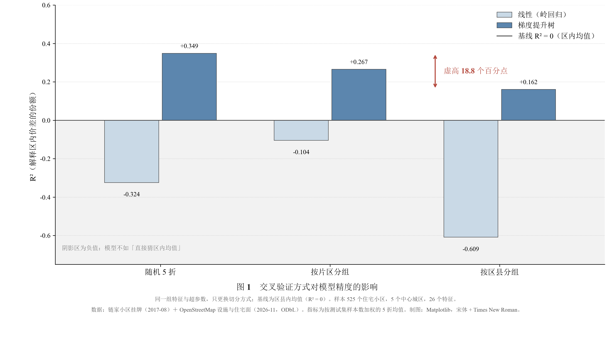

# 成都住宅单价的空间解释力 · 空间交叉验证的必要性

> **一个问题**：把「你在哪个区」这个最强的价格因素扣掉之后，区位、形态、配套还能解释多少？
>
> **一个答案**：随机切分的 R²=0.35 是假的；按区县分组后只有 **0.16**——**18.8 个百分点是空间自相关灌进来的**。
>
> 一条命令重建：`python run_model.py`（10 078 行原始挂牌 → 525 个样本 → 3 张图 + 1 张模型卡，约 3.5 分钟）


<sub>图 1　交叉验证方式对模型精度的影响</sub>

---

## 一、这是什么

一个**方法论演示项目**，不是房价预测器。它做四件事：

1. **把没有坐标的价格数据变成有坐标的样本**：链家小区表 10 078 行一个经纬度都没有，用「小区名 → OSM 住宅面质心」的名称关联拿到 649 个真几何坐标（命中率 9.6%，丢掉的都记了账）
2. **把城市级价差从模型里摘出去**：目标变量改成「区内相对价」（区县内 log 单价的 z-score），剩下的才是空间分析该解释的东西
3. **同台对比三套切分**：随机 5 折 / 按片区 5 折 / 按区县 5 折，同一份特征、同一套参数，只换切分
4. **把残差落回地图**：用双向发散色阶看模型在哪些片区系统性看错，并用 Moran's I 检验残差是否仍在空间上成团

样本：**525 个住宅小区**，5 个中心城区（金牛 135 / 武侯 124 / 成华 122 / 青羊 84 / 锦江 60），96 个片区，26 个特征。


<sub>图 2　模型残差的空间分布</sub>

## 二、解决什么问题

甲方给的活儿，十次有八次是「我有数据，你帮我看看为什么」。这种活最容易犯的两个错：

- **拿随机交叉验证的分数当结论**。房价数据空间自相关极强，随机切分会让隔壁小区同时出现在训练集和测试集，分数虚高一截，交付后一用就露馅。本项目把这个虚高**量化出来并画成图**：0.349 → 0.162，虚高 18.8 个百分点。
- **把「哪个区贵」当成「空间分析」**。区县哑变量一进模型 R² 立刻好看，但它只是查表。去掉它（区内去均值）之后，模型还剩多少本事，才是真问题。

所以这个项目可以当成一个「专业信号」：它输出的不是一张好看的预测图，而是**一句可以拿去说服客户的话**——「您这个项目如果想要可信的精度评估，切分必须按空间单元分组，否则数字是虚的」。


<sub>图 3　各特征的置换重要性</sub>

## 三、怎么跑

```bash
pip install -r requirements.txt

python run_model.py                 # 四段全跑：prepare → features → model → figures
python run_model.py --skip-figures  # 只出数据与指标
python run_model.py --stages model,figures   # 只跑指定段
```

**前置依赖**：`../geo-etl-pipeline/data/chengdu.db`（本仓库使用的设施、地铁站、区县面、住宅单元表都由那个项目产出，口径必须一致；缺它 `prepare.py` 会直接报错退出）。

跑完的输出：

| 目录 | 内容 |
|---|---|
| `raw/` | 链家原始表（只读，一个字节不改） |
| `build/` | `samples.csv`（525）、`features.csv`（525 × 26）、`oof_predictions.csv`、`cv_results.json`、`match_log.json`、`feature_manifest.csv`、`feature_log.json` |
| `docs/` | 三张图 + `data_manifest.md` + `model_card.md` |

`run_model.py` 结尾自动做四处一致性检查（样本/特征/OOF 行数一致、可达性特征无缺失、3×3 组结果齐、三张图在位），任一不过就以非零码退出。

## 四、设计与取舍

| # | 决定 | 为什么 | 代价 |
|---|---|---|---|
| 1 | 目标变量用**区内相对价**，不用绝对单价 | 绝对价里九成信息是「你在哪个区」；而价格是 2017、设施是 2026，中间 9 年的普涨也会被算进空间系数。区内 z-score 同时解决这两个问题 | 结论只适用于「区内差异」，不能说「这个区比那个区贵多少」 |
| 2 | 坐标靠**名称关联**，不做地理编码 | 链家/贝壳详情页在本机返拦截页，高德/百度要 key。名称关联拿到的坐标是真几何质心，不是猜的 | 命中率 9.6%，样本偏向有名气、成规模的小区 |
| 3 | 同名多候选用「区县」消歧，**跨区同名一律丢弃** | 宁可少 30 个样本，也不要一个把锦江的小区挂到金牛的坐标 | 少 30 行（21 同区多候选 + 9 跨区） |
| 4 | **整区剔除新都、龙泉驿** | 这两区只剩 11 个样本，区内标准差由 5–6 个数估计，z-score 与残差全都会被带歪 | 少 11 行，覆盖退到 5 个中心城区 |
| 5 | 线性那一支用**岭回归**（α=1） | 26 个特征里有成组共线，普通 OLS 在其中一折上数值爆炸（实测出现过 -4.4e24 的单折 R²） | 系数不再是无偏 OLS 解 |
| 6 | 指标用**按样本数加权的折均值**，不拼接各折 OOF 算全局 R² | 各折的 z 基准不同（均值/标准差只用训练折估计），拼接后算全局 R² 是错的——同一套代码拼接算出来的线性 R² 是 -0.49，那是基准错位不是模型差 | 与「全局 R²」这个常见说法不一致，需在 README 解释 |
| 7 | 三套切分**全部报出来**，不只报最好的 | 只报随机 CV 就是骗人；只报按区县又显得模型一无是处 | 表格变长 |
| 8 | 空间特征单独跑一遍消融 | 不跑的话没人知道「空间特征到底有没有用」——结果是**没有**（按区县 -0.579），这句话必须敢写 | 结论不利于「GIS 能解释房价」这一直觉 |
| 9 | 残差用**双向发散色阶**，0 居中 | 残差有正负方向，暖=低估、冷=高估，一眼看出系统性偏差 | 不用彩虹色，视觉冲击弱一点 |
| 10 | 三张图的脚注都写数据年份与不可用途 | 这份数据的年份错位是最容易被攻击的点，主动写在图面上比藏在 README 里强 | 图面文字变多 |

## 五、结论与局限

**三个可以写进交付物里的结论**：

1. **随机 CV 会把空间数据的精度虚高一截**：0.349 → 0.162，虚高 18.8 个百分点。任何空间数据的精度评估，切分都应按空间单元分组
2. **控制小区自身品质后，区位可达性的解释力很有限**：物业费一项的置换重要性（0.543）就超过全部空间特征之和；空间特征单独用，在跨区预测时甚至不如基线
3. **残差仍成团**（Moran's I = 0.234，p = 0.001）：模型漏掉的不是「某个距离」，而是学区、商圈成熟度这类数据里根本没有的变量

**五条局限**：样本仅 525 且偏向有名小区；价格 2017 与设施 2026 时间错位；缺学区/商圈/装修；置换重要性不等于因果；结论只覆盖主城 5 区。

**不可用途**：定价、估值、投资建议、信贷评估、对外发布片区房价排名。可用于方法演示、教学与「还缺哪些变量」的清单。详见 [`docs/model_card.md`](docs/model_card.md)。

## 六、English Summary

A methodology demo on Chengdu resale-housing prices (5 downtown districts, 525 residential blocks, 26 features).

The point is not the model but the **evaluation**. Using random 5-fold CV the gradient-boosting model reaches R² = 0.35; grouped by district it drops to **0.16** — an **18.8 pp inflation caused by spatial autocorrelation**. Three split schemes (random / grouped by sub-district / grouped by district) are run on identical features and hyper-parameters, so the gap is attributable to the split alone.

The target is the **within-district z-score of log unit price**, which removes both the "which district" effect and the 2017-vs-2026 level drift between the price table and the OSM feature snapshot.

Findings: (1) spatial features alone perform *worse than the baseline* under district-wise cross-validation (−0.58), because after district centring they mostly encode district position; (2) property-management fee alone dominates permutation importance (0.543); (3) out-of-fold residuals remain spatially clustered (Moran's I = 0.234, p = 0.001), i.e. the missing variables are school districts and commercial maturity — data we do not have.

Reproduce: `python run_model.py` (~3.5 min, deterministic, `random_state=42`).

Data: Lianjia listing snapshot 2017-08 (research use only) + © OpenStreetMap contributors, ODbL 1.0.
